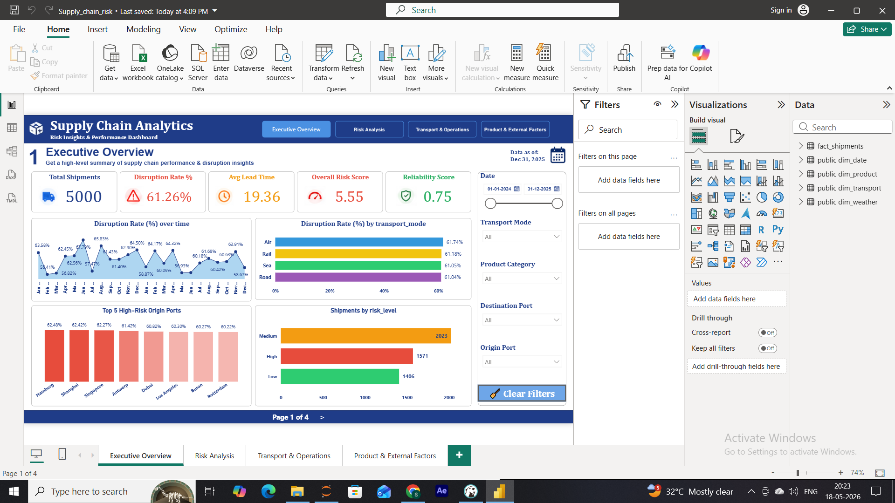
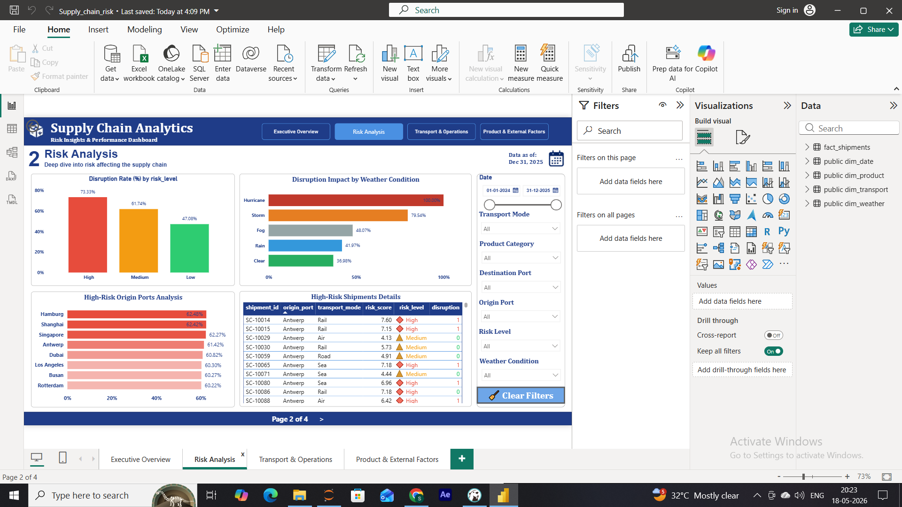
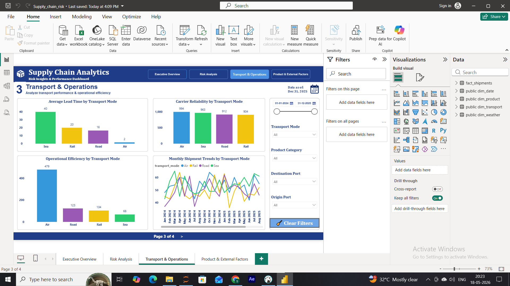
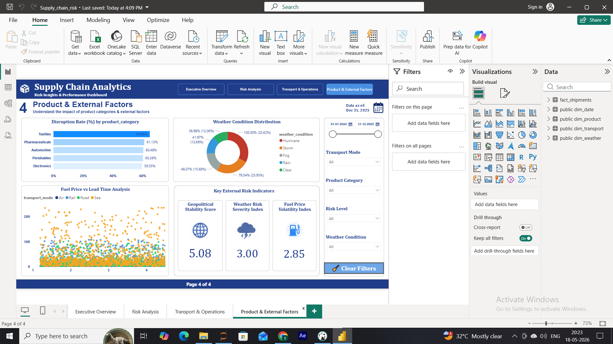
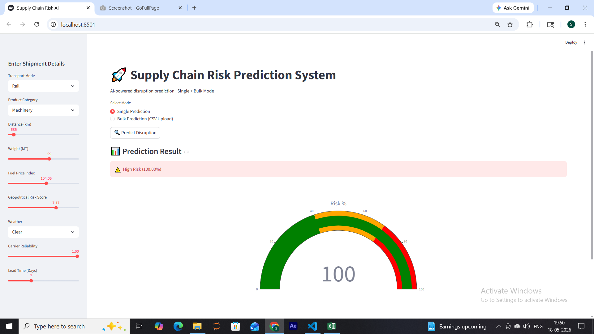
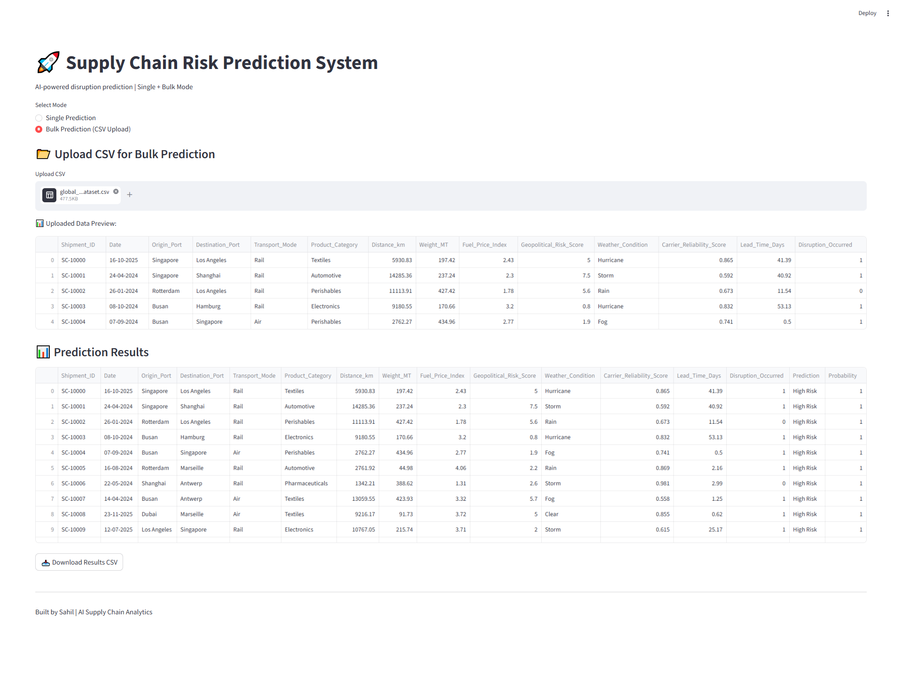

# 🚀 AI-Driven Supply Chain Risk & Logistics Optimization System


---

## 📌 Project Overview
An end-to-end **Supply Chain Analytics & Risk Prediction System** built using **SQL, Python, and Power BI**.

This project analyzes **5,000 global shipments** to:
- Identify disruption risks
- Optimize logistics decisions
- Predict shipment disruptions using Machine Learning

---

## 🧱 Tech Stack
- **SQL:** PostgreSQL (Star Schema)
- **Python:** Pandas, NumPy, Matplotlib, Seaborn, Scikit-learn, XGBoost
- **Visualization:** Power BI
- **App:** Streamlit, Plotly

> ✅ Dependencies are pinned in [`requirements.txt`](requirements.txt): `pandas`, `numpy`, `matplotlib`, `seaborn`, `scikit-learn`, `xgboost`, `plotly`, `streamlit`, `psycopg2-binary`.

---

## 🗄️ Data Architecture
- Fact Table: `fact_shipments`
- Dimension Tables:
  - `dim_date`
  - `dim_transport`
  - `dim_product`
  - `dim_weather`

✔️ Built with a **Star Schema** design (`sql/Schema.sql`)

---

## 📊 Key Business Insights

### 🚨 Critical KPI
- **Total Shipments:** 5,000
- **Disruption Rate:** 61.26%
- **Avg Delivery Time:** 19.36 days
- **Avg Carrier Reliability:** 0.75
- **Overall Risk Score:** 5.55

---

### 🚚 Transport Performance
Disruption rate by mode is close across the board, with Air the highest and Sea the lowest:
- Air → **61.74%** disruption (fastest, but riskiest)
- Rail → **61.18%**
- Sea → **61.05%** (most stable)
- Road → **61.04%**

---

### 🌦️ Weather Impact
- Hurricane → **100%** disruption
- Storm → **~80%** (79.54%)
- Fog → **~48%**
- Rain → **~42%**
- Clear → **~37%** (lowest risk)

---

### ⏱️ Risk Level & Delivery Speed Impact
- High risk shipments → **73.33%** disruption rate
- Medium risk shipments → **61.74%**
- Low risk shipments → **47.08%**
- Slow deliveries → **~70%** disruption
- Fast deliveries → **~53%** disruption

---

### 📦 Product Risk
- Textiles → highest disruption
- Electronics → most efficient / lowest disruption
- Top high-risk origin ports: **Hamburg (62.48%), Shanghai (62.42%), Singapore (62.27%)**

---

## 🤖 Machine Learning Model

### Models Used (GridSearchCV-tuned):
| Model | Accuracy | F1 Score | ROC-AUC |
|---|---|---|---|
| **Logistic Regression ✅ (Best)** | 0.738 | 0.788 | 0.827 |
| XGBoost | 0.731 | 0.782 | 0.821 |
| Random Forest | 0.704 | 0.780 | 0.810 |

### Performance:
- **F1 Score:** ~0.78
- **ROC-AUC:** ~0.83
- Balanced precision & recall
- Top features driving disruption: **Hurricane weather, Storm weather, geopolitical risk score, lead time, carrier reliability**

---

## 📊 Power BI Dashboard

### Features:
- KPI Cards
- Risk Analysis (by risk level & weather condition)
- Transport & Operations Analysis
- Product & External Factors
- Monthly Trends

📸 Screenshots:






---

## 🌐 Streamlit Application

Features:
- Single Prediction (sidebar inputs → live gauge chart)
- Bulk CSV Prediction
- Risk Probability Output (Low / High Risk with %)
- Downloadable Prediction Reports (`outputs/bulk_predictions.csv`)

📸 Screenshots:




---

## 📁 Project Structure

```bash
supply-chain-risk-analytics-ml-system/
│
├── app/                         # Streamlit application
│   └── app.py
│
├── data/                        # Raw & processed datasets
│   ├── raw/
│   │   └── global_supply_chain_risk_dataset.csv
│   └── processed/
│       └── cleaned_supply_chain.csv
│
├── images/                      # Screenshots (Dashboard, App)
│   ├── page1.png ... page4.png     # Power BI dashboard pages
│   └── app.png, app2.png           # Streamlit app
│
├── models/                      # Saved ML models
│   ├── best_model.pkl              # Logistic Regression (best)
│   └── scaler.pkl
│
├── notebooks/                   # Jupyter notebooks (EDA, training)
│   ├── 01_data_cleaning.ipynb
│   ├── 02_eda_analysis.ipynb
│   └── 03_ml_model.ipynb
│
├── outputs/                     # Predictions & generated outputs
│   └── bulk_predictions.csv
│
├── powerbi/                     # Power BI dashboard file
│   └── Supply_chain_risk.pbix
│
├── reports/                     # Documentation & reports
│   ├── final_report.md
│   ├── sql_analysis.md
│   ├── ml_insights.md
│   ├── eda_insights.md
│   └── dashboard_explanation.md
│
├── sql/                         # PostgreSQL scripts
│   ├── Schema.sql
│   └── queries.sql
│
├── .devcontainer/                # Dev container config
│   └── devcontainer.json
│
├── requirements.txt             # Python dependencies
└── README.md                    # Main project documentation
```

---

## 💡 Business Recommendations
- Avoid high-risk routes during extreme weather (Hurricane/Storm)
- Prioritize high-reliability carriers, especially for high-risk shipments
- Optimize slow delivery pipelines to cut disruption risk
- Monitor geopolitical risk scores and flag high-risk shipments proactively

---

## 🚀 Future Improvements
- Real-time data pipeline
- ML deployment as an API
- AI-based route optimization system
- Threshold tuning integrated into the app for business-specific risk tolerance

---

## 📢 Conclusion
This project demonstrates a **complete data analytics pipeline**:
➡️ Data Engineering → SQL Analytics → ML Modeling → Dashboard → Deployment

---

## ⭐ If you like this project, give it a star!
